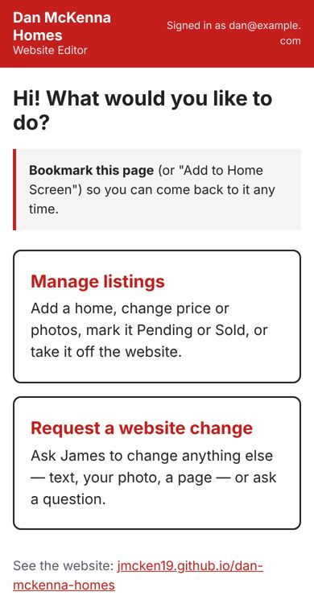
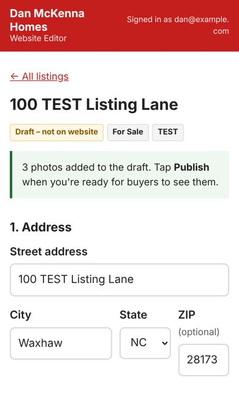
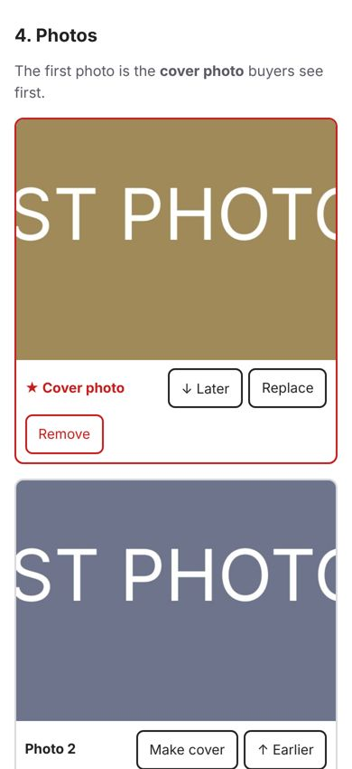
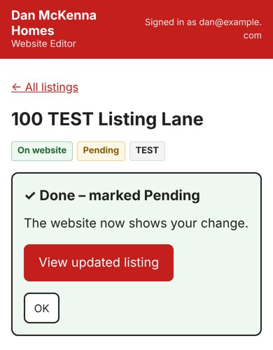
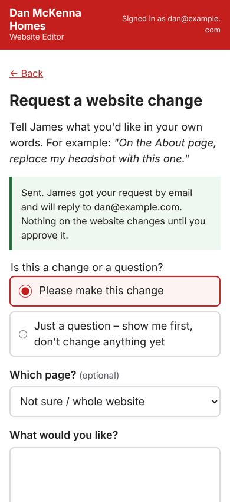

# Your website – one-page guide

## Bookmark this page

**Your editor:** `EDITOR LINK – James fills this in when the editor is switched on`
On iPhone: open the link in Safari → tap the Share button → **Add to Home Screen**.
On Android: open in Chrome → ⋮ menu → **Add to Home screen**.

**Signing in:** type your email (danmckenna@kw.com). You'll get a 6-digit code by email — type it
in. That's it. No password to remember.

**Your website (testing version for now):** https://jmcken19.github.io/dan-mckenna-homes/

---

### Add a home
1. Tap **Manage listings** → **+ Add a new home**.
2. Fill in the address and status. Price, beds, baths and square feet are **optional** — leave a box
   blank if you don't know it. (Blank never shows as "0".)
3. Tap **+ Add photos** and pick several photos at once. The **first photo is the cover**.
4. Tap **Preview** to see it the way buyers will. Nobody else can see it yet.
5. Tap **Publish** → **Yes, publish**. You'll see *"Your changes are being published"*. In 1–3
   minutes it changes to **✓ Done** with a **View updated listing** button.

### Change photos or price
Open the home (search by street address). Change the price and tap **Save draft**.
Under **Photos**: **Make cover**, **↑ Earlier / ↓ Later** to change the order, **Replace**, or **Remove**.
Then tap **Publish changes**. Changed your mind? **Undo my unpublished changes**.

### Mark it Pending or Sold
Open the home → **Mark Pending** or **Mark Sold** → confirm. The website updates on its own.
Sold homes stay on your website under "Recently Sold".

### Take it down (and put it back)
Open the home → **Take off website** → confirm. Buyers no longer see it; anyone with the old link
sees "This home is no longer on Dan's website". It stays in your list, marked
*Taken off website*. To bring it back: open it → **Put back on website**.

### Ask for any other change
Tap **Request a website change**, say what you want in your own words (for example *"On the About
page, replace my headshot with this one"*), attach a photo if needed, and tap **Send to James**.
Pick **"Just a question – show me first"** if you only want to see an idea. You'll see **Sent**,
James gets an email right away and replies to you, and the request's progress shows on that page.

### If something goes wrong
* **"Publishing didn't finish"** – your work is saved. Tap **Try again**. If it happens again, call James.
* **"Changed on another phone or computer"** – tap **Reload latest**; your typing is put back in the boxes.
* **A photo wasn't added** – the message says why and what to do. iPhone photos normally work as they are.
* **Signed out** – tap **Sign in again**; your typing stays on the page.

### Can't sign in at all?
Call or text **James McKenna: `PHONE – fill in`**, or email **`EMAIL – fill in`**. He can make the
change for you, and can add a second email address (for example Wendy's) to the editor.
