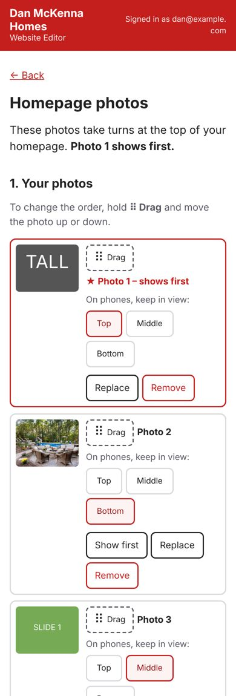

# Your website – one-page guide

## Start here: your Website Editor bookmark

**Your editor:** https://dmh-owner.danmckenna.workers.dev (your **Website Editor** bookmark)
Use your **laptop** – the editor is set up for the laptop only (on a phone it will ask you to use your laptop).
Click your **Website Editor** bookmark (https://dmh-owner.danmckenna.workers.dev).
**Photos from your phone:** send them to your laptop first (email or Google Photos), then add them.

**Signing in:** click the **Website Editor** bookmark. The Cloudflare login page opens – type the email and
password of your **Cloudflare account** (danmckenna@kw.com) and click **Log in**. You stay signed in for 30 days
on that laptop. Forgot the password? Click **Forgot your password?** on that page, or ask James.

**Your website:** https://www.danmckennahomes.com

---

### Change a photo on your website
The editor opens on **Your website photos**. Each box shows one photo and where it appears on the website:
**Your photo** (About us and Contact pages), **New Construction page photo**, and **Luxury home photo**.
1. Click **Replace photo** and pick the new photo – or drag a photo from a folder onto the box.
2. Click **Preview** to see the page with the new photo. Changed your mind? Click **Undo**.
3. Click **Publish** at the bottom of the screen → **Yes, publish**. In 1–3 minutes it says **✓ Done**.

### Change the photos at the top of your homepage
Click **Change slideshow photos**.
* **+ Add photos** – pick one or several. (On a computer you can also drag photos onto that box.)
* **Change the order** – hold **⠿ Drag** and slide the photo up or down. **Photo 1 shows first.**
  Or click **Show first** on any photo.
* **On phones, keep in view: Top / Middle / Bottom** – phones show a narrower slice of the photo;
  choose the part that matters (a roofline → Top, a patio → Bottom).
* **At the top: Slideshow or One still photo.** Slideshow = the photos take turns; One still photo = only Photo 1 shows.
* **Speed** – Slow, **Normal** (recommended) or Fast.  **How the photos change** – **Slide** (recommended) or Fade.
* **Replace** or **Remove** a photo (there must always be at least one).
* Click **Preview** to watch it, then **Publish**. Wide photos look best.

### Anything else
Want a different change – text, a new page, a listing? Just **text James**.

### If something goes wrong
* **"Publishing didn't finish"** – your work is saved. Click **Try again**. If it happens again, call James.
* **"Changed on another phone or computer"** – click **Reload latest**; your typing is put back in the boxes.
* **A photo wasn't added** – the message says why and what to do. iPhone photos normally work as they are.
* **Signed out** – click **Sign in again**; your typing stays on the page.

### Can't sign in at all?
Text or call **James**, or email **jmck2134@gmail.com**. He can make the
change for you, and can add a second email address (for example Wendy's) to the editor.
